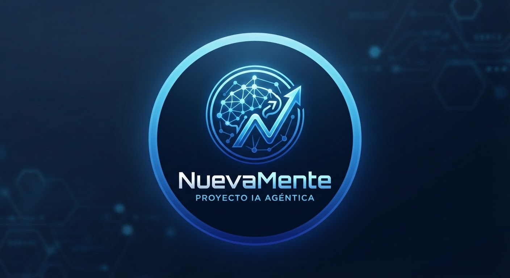
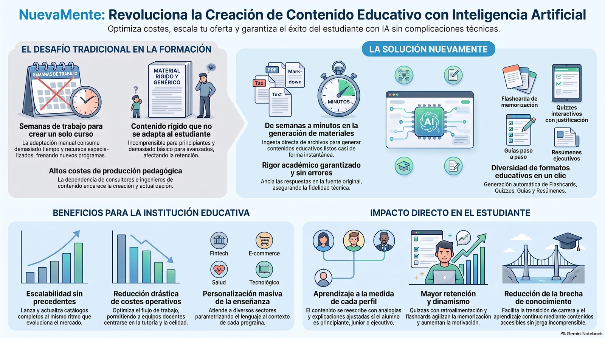
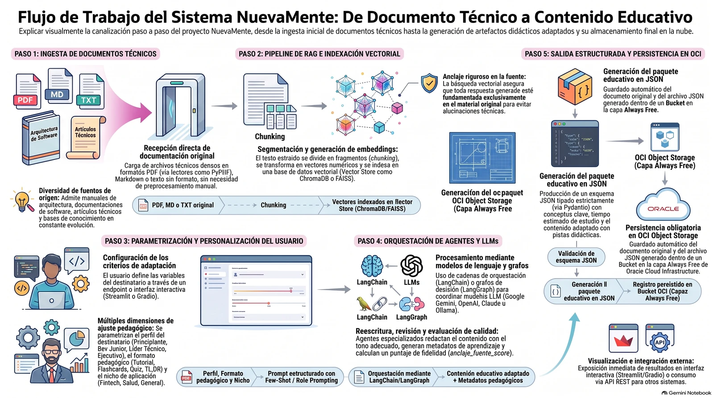
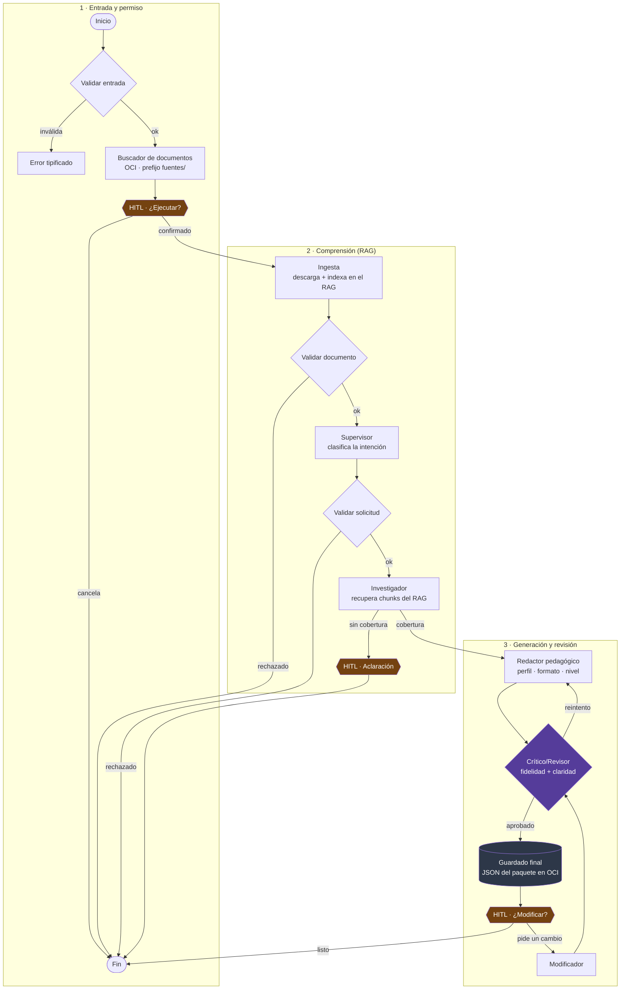
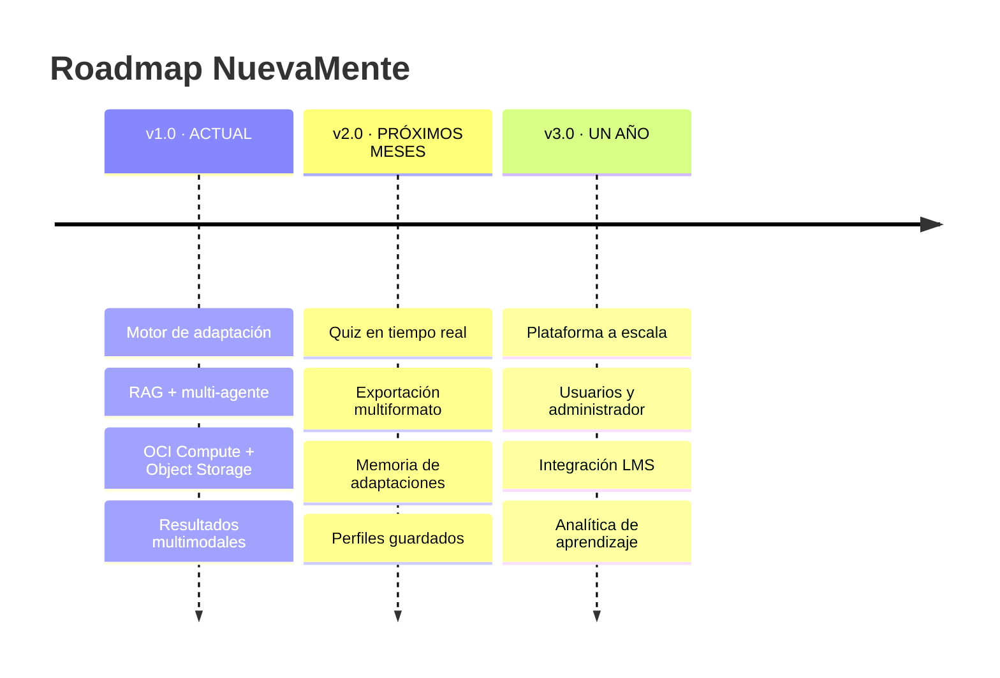

<p align="right" style="float: right;">
  
</p>

# 🎓 NuevaMente

**Sistema Inteligente de Adaptación y Generación de Contenido Educativo**

Hackathon ONE G10 — Oracle Next Education & Alura · Equipo LATAM 28

---

## El problema

Las empresas y escuelas de tecnología producen documentación técnica muy rica, pero a menudo
inaccesible para quien no domina la jerga. Un mismo manual de infraestructura en la nube
necesita enseñarse de maneras muy distintas a quien da sus primeros pasos en programación y
a quien toma decisiones ejecutivas de inversión.

Adaptar ese material a mano consume **semanas** de trabajo de especialistas y diseñadores
instruccionales.

## La solución

NuevaMente ingiere documentación técnica (PDF, Markdown o texto) y la convierte automáticamente
en **paquetes educativos personalizados**, parametrizados por perfil del destinatario, formato
pedagógico y nicho de aplicación. Minutos en lugar de semanas.

**El diferenciador no es generar contenido con IA — eso es commodity. Es generar contenido con
fidelidad verificable a la fuente.** Cada paquete trae un `anclaje_fuente_score` calculado por un
agente verificador independiente, y cada ítem declara de qué fragmento del documento original salió.



---

## Cómo funciona



---

### Pipeline de adaptación



### Las tres piezas que lo distinguen

**1 · RAG con trazabilidad por fragmento.** Cada chunk conserva su documento de origen y su
posición. Sin eso, un puntaje de fidelidad sería un número inventado.

**2 · Verificador independiente.** Una segunda llamada al LLM, con rol distinto, recibe *sólo*
las afirmaciones generadas y los chunks recuperados — nunca el prompt del redactor ni el perfil.
Clasifica cada afirmación como soportada, parcial o no soportada. El score es la proporción
soportada. **No es el mismo modelo poniéndose una nota.**

**3 · Adaptación cognitiva, no cosmética.** El perfil no se pasa como una instrucción vaga al
modelo: se traduce a parámetros concretos —nivel de la taxonomía de Bloom, grado de andamiaje,
registro lingüístico y foco— que el redactor consume. Así el contenido no cambia sólo de tono,
cambia de nivel cognitivo.

---

## Stack

         

| Capa | Tecnología |
|---|---|
| Lenguaje | Python 3.12 |
| LLM de los agentes | **Groq** — cascada `openai/gpt-oss-120b` → `openai/gpt-oss-20b` → `qwen/qwen3.8-27b`, con fallback por cupo |
| Embeddings | **Hugging Face** `intfloat/multilingual-e5-base` (API `hf-inference`, 768 dimensiones) |
| Framework de agentes y LLM | LangChain |
| Orquestación | LangGraph |
| Protocolo de herramientas | MCP (`mcp` + `langchain-mcp-adapters`) |
| Vector store | ChromaDB, una colección por documento |
| Validación | Pydantic v2 |
| Extracción de documentos | pypdf |
| Exportación PDF / Markdown | ReportLab |
| Interfaz | Streamlit |
| Persistencia | **Oracle Cloud Infrastructure — Object Storage, capa Always Free** |

Hay dos factories de LLM. `src/seguridad/llm_client.py` es la que usan los **agentes del grafo**
(hoy Groq, con cascada de modelos y fallback por cupo real). `src/llm_provider.py` es la
intercambiable por `.env` (Gemini, DeepSeek, Claude, Ollama, Kimi) que usan scripts y notebooks.
Ningún otro archivo del proyecto nombra un proveedor.

---

## Instalación

### Requisitos

- Python 3.11 o superior
- Una cuenta de Oracle Cloud con un bucket de Object Storage en la capa Always Free
- Un **token de Hugging Face** (`HF_TOKEN`) — embeddings e5 del RAG ([huggingface.co/settings/tokens](https://huggingface.co/settings/tokens))
- Una **clave de Groq** (`GROQ_API_KEY`) — agentes del grafo ([console.groq.com/keys](https://console.groq.com/keys))
- *(Opcional)* una clave de Gemini u otro proveedor, si usas `llm_provider.py` ([aistudio.google.com/apikey](https://aistudio.google.com/apikey))
- *(Opcional)* [Ollama](https://ollama.com/download), solo si prefieres embeddings locales por `llm_provider.py`

### Pasos

```bash
# 1. Clonar
git clone https://github.com/<organizacion>/G10-LATAM-equipo-28.git
cd G10-LATAM-equipo-28

# 2. Entorno virtual
python -m venv .venv
source .venv/bin/activate          # Windows:  .venv\Scripts\activate

# 3. Dependencias
pip install -r requirements.txt

# 4. Configuración
cp .env.example .env               # Windows:  copy .env.example .env
#    Abrir .env y completar: HF_TOKEN, GROQ_API_KEY, OCI_BUCKET_NAME, OCI_NAMESPACE

# 5. Credenciales de OCI
#    Consola OCI → Perfil → My profile → API keys → Add API key
#    Guardar el bloque de configuración en ~/.oci/config

# 6. Verificar que todo quedó bien
python verificar_entorno.py
```

`verificar_entorno.py` revisa las 20+ condiciones necesarias y, por cada una que falle, dice
el comando exacto para arreglarla.

> ⚠️ El archivo `.env` **nunca** se versiona. Ya está en el `.gitignore`. Una clave subida a
> GitHub no se borra con `git rm`: queda en el historial y hay que rotarla.

### Ejecutar

```bash
streamlit run app.py        # interfaz
pytest tests/ -q            # pruebas
```

---

## Estructura

```
.
├── AGENTS.md               guía operativa para agentes
├── CLAUDE.md               memoria del proyecto (decisiones, contrato, reglas)
├── app.py                  interfaz Streamlit
├── verificar_entorno.py    verificador de entorno
├── src/
│   ├── config.py           toda la configuración entra por aquí
│   ├── llm_provider.py     único archivo que nombra proveedores de LLM
│   ├── errores.py          catálogo de códigos y contrato de error
│   ├── contracts/          ⭐ la frontera del sistema — congelado
│   ├── agent_state.py      estado compartido del grafo
│   ├── grafo.py            grafo LangGraph y sus nodos
│   ├── agentes/            los 5 agentes del flujo
│   ├── pedagogia/          perfil → parámetros pedagógicos
│   ├── prompts/            plantillas, fuera de la lógica
│   ├── seguridad/          validación, rate limiting y permisos
│   ├── servidor_objeStorageOracle.py   servidor MCP de OCI Object Storage
│   └── Cliente_agemte.py   cliente MCP
├── notebooks/              pipeline documentada (01–04)
├── tests/
└── docs/                   especificación funcional y decisiones
```

`src/contracts/` es la frontera: mientras esos modelos estén congelados, el equipo trabaja en
paralelo sin pisarse. Cada quien programa contra el contrato, no contra el código del otro.

---

## El contrato

**Entrada:**

```json
{
  "documento_titulo": "Introduccion a la Arquitectura de Redes VCN en OCI",
  "documento_contenido": "La Virtual Cloud Network (VCN) es una red privada...",
  "perfil_destinatario": "Principiante",
  "formato_salida": "Flashcards",
  "nicho_sector": "General",
  "nivel_detalle": "Didactico"
}
```

**Salida:**

```json
{
  "status": "exito",
  "metadatos": {
    "perfil_aplicado": "Principiante",
    "formato_generado": "Flashcards",
    "tiempo_estimado_estudio_minutos": 5,
    "conceptos_clave": ["VCN", "Subredes", "Internet Gateway", "Security Lists"],
    "prerrequisitos": ["Nociones basicas de redes"]
  },
  "contenido_adaptado": {
    "titulo": "Dominando Redes en la Nube (VCN) desde Cero",
    "introduccion_contextualizada": "Imagina la VCN como tu propio barrio privado...",
    "items": [
      {
        "frente": "Que es una VCN en Oracle Cloud?",
        "dorso": "Es tu red virtual privada dentro de la nube de Oracle.",
        "pista_didactica": "Piensa en ella como el terreno cercado donde residen tus servidores.",
        "anclaje": ["chunk_001"]
      }
    ]
  },
  "evaluacion_calidad": {
    "anclaje_fuente_score": 0.98,
    "claridad_pedagogica": "Alta",
    "observaciones": "Lenguaje ajustado con analogias para publico principiante."
  },
  "almacenamiento_oci": {
    "bucket": "nuevamente-contenidos-educativos",
    "objeto_id": "contenido-vcn-principiante-flashcards-001.json",
    "status_upload": "completado"
  }
}
```

### Parámetros

| Parámetro | Valores |
|---|---|
| `perfil_destinatario` | `Principiante` · `Desarrollador` · `Lider Tecnico` · `Gestor Ejecutivo` |
| `formato_salida` | `Flashcards` · `Tutorial` · `Resumen Ejecutivo` · `Quiz` |
| `nicho_sector` | `Fintech` · `Salud` · `E-commerce` · `General` |
| `nivel_detalle` | `Didactico` · `Estandar` · `Profundo` |

Se acepta también la forma larga de cada valor (`"Principiante / Transición de Carrera"`,
`"Flashcards de Memorización"`), con o sin tildes.

---

## Roadmap

NuevaMente está diseñada para evolucionar desde un motor de adaptación de documentación técnica
con **fidelidad verificable** hacia una plataforma de capacitación técnica a escala.

| Versión | Horizonte | Enfoque |
|---|---|---|
| **1.0** | **Actual** | Motor de adaptación completo: ingesta (PDF · MD · TXT), pipeline RAG, orquestación multi-agente con verificación de fidelidad, salida JSON estructurada, **despliegue en OCI** (Compute + Object Storage, capa Always Free) e interfaz Streamlit. Genera **resultados multimodales**. |
| **2.0** | **Próximos meses** | Adiciones de implementación inmediata: quiz interactivo con evaluación en tiempo real, exportación multiformato ampliada (CSV compatible con Anki), memoria de adaptaciones y perfiles guardados. |
| **3.0** | **Un año** | Plataforma de capacitación a escala: perfiles de usuario y administrador, integración con LMS y APIs externas, catálogo de paquetes educativos y analítica de aprendizaje. |

> **Nota:** Las versiones 2.0 y 3.0 describen la evolución proyectada del proyecto; la **versión
> actual (1.0)** es la que se presenta en el Hackathon.

### Roadmap visual



---

## Documentación

| Documento | Contenido |
|---|---|
| [`docs/nuevamente-especificacion-funcional.md`](docs/nuevamente-especificacion-funcional.md) | Especificación funcional: requisitos MUST, user stories, criterios de aceptación y matriz de trazabilidad |
| [`docs/02_Decision-gate_v2_RESUELTO.md`](docs/02_Decision-gate_v2_RESUELTO.md) | Decisiones de producto y esquemas JSON de cada formato pedagógico |
| [`docs/03_Propuesta-Marelys_y_config-LLM.md`](docs/03_Propuesta-Marelys_y_config-LLM.md) | Análisis de la propuesta de producto y configuración intercambiable de LLM |
| [`docs/04_Arquitectura-y-plan-de-trabajo.md`](docs/04_Arquitectura-y-plan-de-trabajo.md) | Arquitectura y plan de trabajo: decisiones técnicas con su justificación |
| [`docs/05_Arranque-del-equipo.md`](docs/05_Arranque-del-equipo.md) | Hoja de arranque: prerrequisitos y reparto de trabajo |
| [`docs/06_explicacion-pedagogica.md`](docs/06_explicacion-pedagogica.md) | Capa de adaptación pedagógica (perfil → parámetros) |
| [`docs/orquestacion-y-agentes.md`](docs/orquestacion-y-agentes.md) | Carril de orquestación: agentes, grafo LangGraph y HITL |
| [`docs/integracion_redactor_fase2b.md`](docs/integracion_redactor_fase2b.md) | Integración del redactor al pipeline (fase 2C) |
| [`docs/seguridad_sprint3.md`](docs/seguridad_sprint3.md) | Seguridad de entrada, red y permisos de herramientas |
| [`AGENTS.md`](AGENTS.md) | Guía operativa para agentes que trabajan en el repo |
| [`CLAUDE.md`](CLAUDE.md) | Memoria del proyecto (decisiones, contrato, reglas) |
| [`CHANGELOG.md`](CHANGELOG.md) | Historial de cambios |

Cada afirmación sobre el Hackathon en esos documentos está etiquetada `[EXP]` (explícito en el
documento oficial, con página), `[INF]` (inferencia necesaria) o `[PROP]` (propuesta).

---

## Equipo NuevaMente

| Integrante | Rol | Funciones principales |
|---|---|---|
| Franklin Bonalde [](https://www.linkedin.com/in/franklinbonaldeai/) | 🧭 Arquitectura y pipelines de Python | Integración del sistema, OCI y despliegue; `app.py` (composition root); resolución de conflictos del grafo |
| Oscar Serna Prado [](https://www.linkedin.com/in/oscar-hserna/) | 🔍 RAG y grafo | Ingesta, chunking, embeddings, ChromaDB y recuperación; grafo LangGraph; README |
| Sergio Carey Alegre [](https://www.linkedin.com/in/sergio-enrique-carey-alegre-58b318174/) | 📚 Pedagogía | Adaptación pedagógica por perfil y nivel, implementación e integración del Redactor con el grafo, validación de entrada, guardia de red y privilegios mínimos. |
| Marely Cárcamo Quisto [](https://www.linkedin.com/in/marely/) | 🧩 Agentes y orquestación | Supervisor, investigador, crítico/revisor y modificador; ajustes al grafo; README; video (con Ignacio) |
| Víctor Asencio Espino [](https://www.linkedin.com/in/veasencioespino/) | 🛠️ Calidad y documentación | Generación dinámica de informes en **PDF** (ReportLab, con indicadores del RAG) y **Markdown** ([detalle del módulo](docs/MODULO_INFORMES.md)); QA y verificación |
| Ignacio Díaz Cuevas [](https://www.linkedin.com/in/id7-rev2213/) | 📋 PM y documentación | Planificación, coordinación y entregables; documentación para la plataforma NoCountry; video (con Marely) |

Grupo 10 · LATAM · Equipo 28 — Programa ONE, Oracle Next Education & Alura.

---

## Licencia

Proyecto académico desarrollado en el marco del Programa ONE. Uso exclusivo de servicios de la
capa Always Free de Oracle Cloud Infrastructure.
